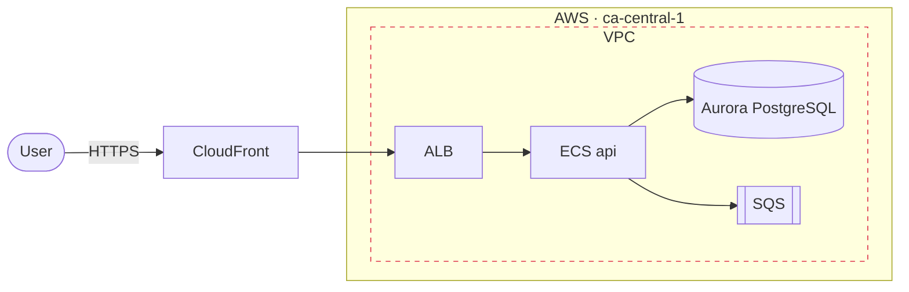
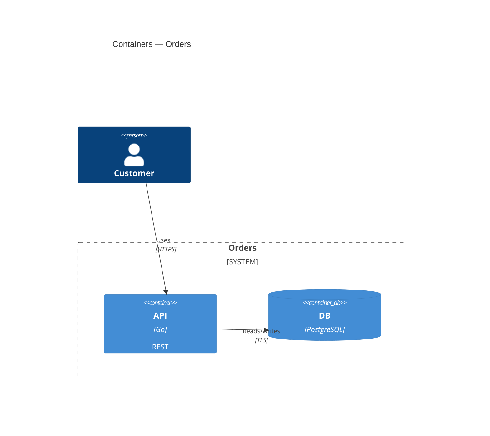
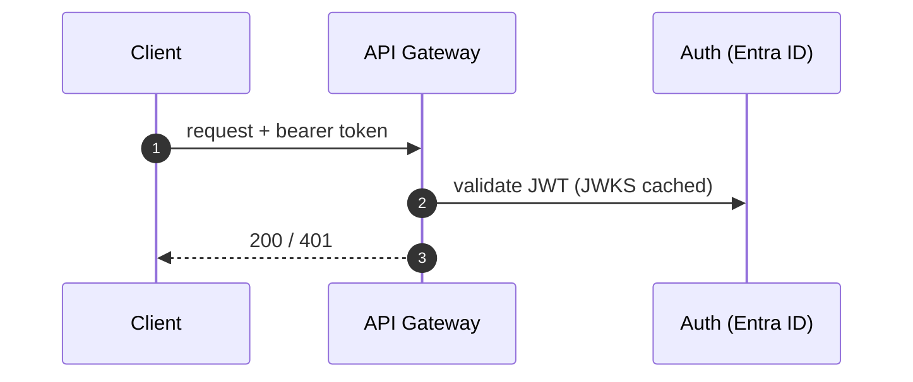

# Architecture diagrams as code

## Pick the format
| Need | Format | Why |
|---|---|---|
| Diagram inside README / ADR / PR | **Mermaid** | GitHub/GitLab render it natively; zero tooling |
| C4 model (context → container → component) | **Structurizr DSL** (model once, many views) or **C4-PlantUML** | Consistent C4 notation, versioned |
| Cloud diagram with official AWS/Azure/GCP/K8s icons, as code | **Python `diagrams`** (mingrammer) | Real vendor icons, regenerable PNG/SVG |
| Polished stakeholder diagram / manual layout | **draw.io** → load `drawio-diagrams` | Pixel control, editable by humans |
| Pretty text diagrams with auto-layout | **D2** | Clean themes, containers, sequence |
| Sequence / deployment / state (UML) | **PlantUML** or Mermaid `sequenceDiagram` | Mature UML |
| Dependency / call graphs from data | **Graphviz DOT** | Generated from scripts (e.g. `go mod graph`, Terraform `graph`) |

Default: Mermaid for docs, Python `diagrams` or draw.io for cloud infrastructure views.

## Standard diagram set for a system
1. **C4 L1 System context** — users, the system, external systems.
2. **C4 L2 Containers** — apps, APIs, DBs, queues, with protocols.
3. **Deployment / infrastructure** — cloud accounts, regions, VPC/subnets, clusters, managed services (vendor icons).
4. **Key sequences** — 1–3 critical flows (auth, checkout, deploy).
5. **Data flow + trust boundaries** — feeds the `threat-modeling` skill.
6. **Network** (home lab / hybrid) — subnets, IPs, DNS, ingress/egress.

## Mermaid templates




## Python `diagrams` (cloud icons)
```python
# docs/diagrams/web_service.py — run: uv run --with diagrams python docs/diagrams/web_service.py  (needs graphviz)
from diagrams import Cluster, Diagram, Edge
from diagrams.aws.compute import ECS
from diagrams.aws.database import Aurora
from diagrams.aws.network import ALB, CloudFront, Route53
from diagrams.aws.integration import SQS

with Diagram("Web service", filename="docs/diagrams/web-service", outformat=["png", "svg"], show=False, direction="LR"):
    dns = Route53("dns")
    cdn = CloudFront("cdn")
    with Cluster("VPC"):
        lb = ALB("alb")
        with Cluster("ECS service"):
            api = [ECS("api-1"), ECS("api-2")]
        db = Aurora("orders-db")
        queue = SQS("events")
    dns >> cdn >> lb >> api
    api >> Edge(label="TLS") >> db
    api >> queue
```
Providers: `diagrams.aws.*`, `diagrams.azure.*`, `diagrams.gcp.*`, `diagrams.k8s.*`, `diagrams.onprem.*` (Docker, Grafana, Prometheus, Nginx…), `diagrams.programming.*`.

## Rendering (commands write files — they run only where the agent may create files)
```bash
npx -y @mermaid-js/mermaid-cli -i docs/diagrams/x.mmd -o docs/diagrams/x.svg      # Mermaid (mmdc)
d2 --layout elk docs/diagrams/x.d2 docs/diagrams/x.svg                           # D2
dot -Tsvg docs/diagrams/x.dot -o docs/diagrams/x.svg                             # Graphviz
docker run --rm -v "$PWD":/work -w /work plantuml/plantuml -tsvg docs/diagrams/x.puml   # PlantUML
docker run --rm -v "$PWD":/usr/local/structurizr structurizr/cli export -workspace docs/architecture/workspace.dsl -format mermaid
terraform graph | dot -Tsvg > docs/diagrams/tf-graph.svg                          # IaC dependency graph
```

## Conventions
- Sources in `docs/diagrams/` (`kebab-case`), rendered SVG committed next to the source; embed SVG in Markdown.
- Every diagram: title, scope/date, legend when colours/line styles carry meaning, protocols + ports on edges.
- Show trust boundaries, data stores and external dependencies explicitly; number flows.
- Don't put secrets, account IDs or public IPs in diagrams destined for public repos (home-lab IPs are fine in private repos).
- Keep one level of abstraction per diagram; split rather than cram (> ~20 nodes → split).
